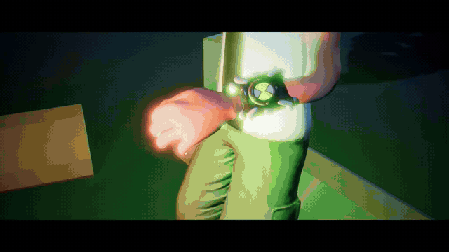
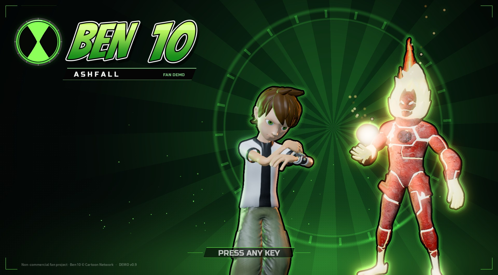
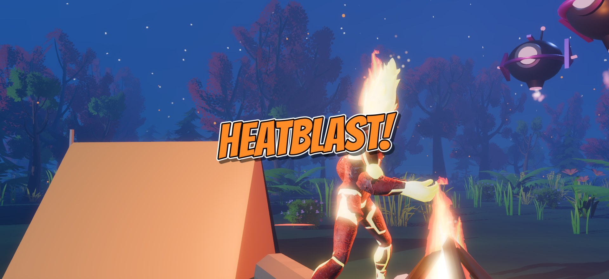
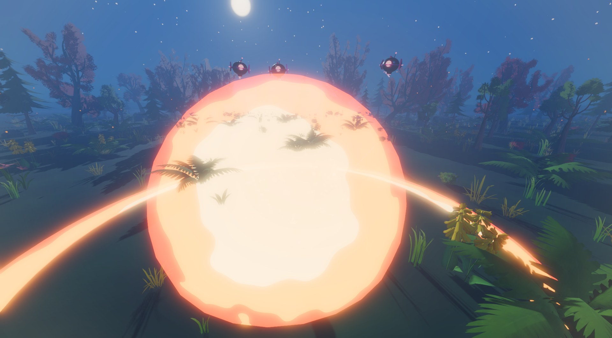
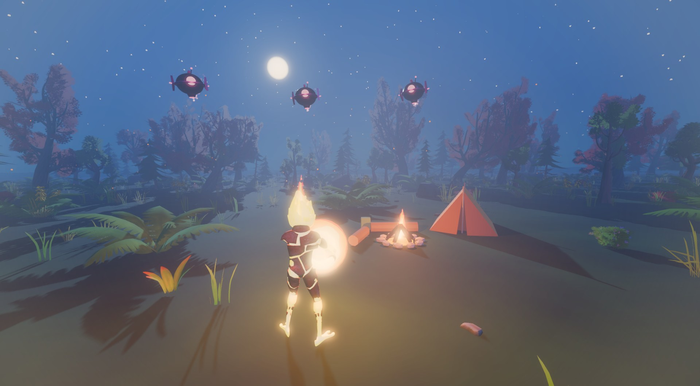
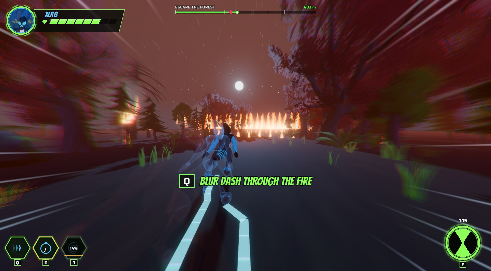
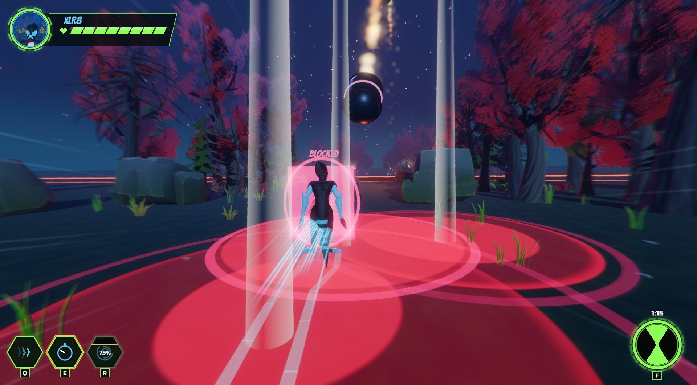
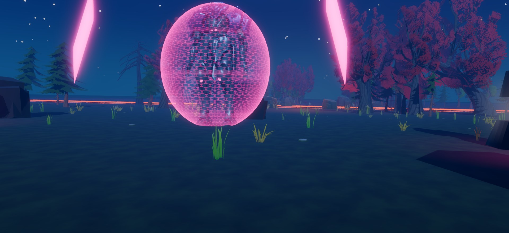
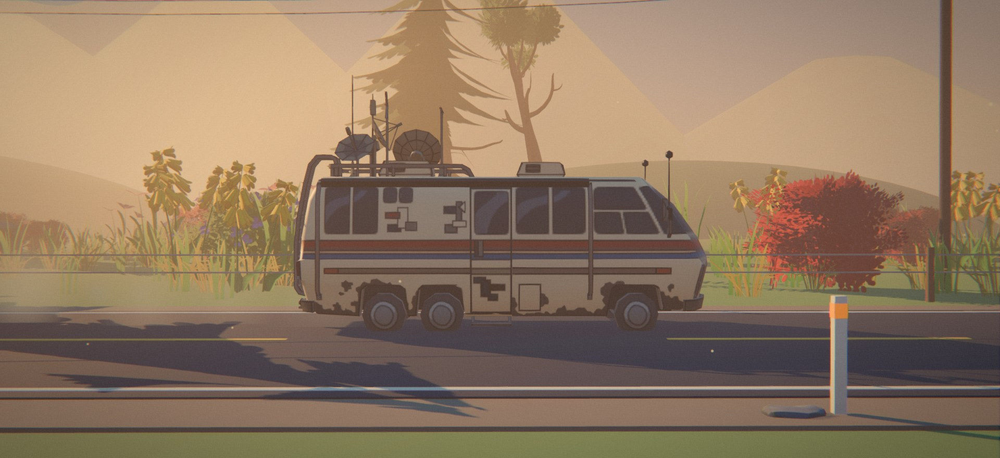

# Ben 10: Ashfall

**A free, unofficial Ben 10 fan game for Windows.** Third-person action: play as Heatblast and XLR8, escape a burning forest, and fight a giant Sentinel.

*Click the preview to watch the full 73-second trailer.*

> Fan project, not affiliated with or endorsed by Cartoon Network or Warner Bros. Discovery. Ben 10 and all related characters belong to their owners. Free, non-commercial, made by a fan for fans.

## Download

Go to the **[Releases page](../../releases/latest)**, download `Ben10-Ashfall-PC.zip`, unzip it and run `Ben10-Ashfall.exe`. No installer.

- Windows 10 or 11, 64-bit. A dedicated graphics card is recommended.
- About 165 MB to download, about 370 MB unpacked.
- Windows may show a "Windows protected your PC" notice because the game isn't code-signed. Click **More info**, then **Run anyway**.

## The story

A quiet night at camp turns bad when scout drones find Ben. He slaps the watch and becomes Heatblast, and the fight sets the forest on fire. The watch times out, a Sentinel crashes out of the sky, and Ben has to run.

## What's in the demo

Seven chapters, all playable from the main menu:

1. **Camp**: the opening cutscene.
2. **Teaching fight**: learn Heatblast's moves one step at a time, from punches to the Supernova.
3. **Burning forest**: the forest goes up, and the watch reveals XLR8.
4. **Escape run**: a 720 m chase through the fire with the Sentinel behind you.
5. **The valley**: drop pods land and DNAliens swarm. Fight them as XLR8.
6. **The Sentinel**: a boss fight with a shield dome, generators, lasers and shockwaves.
7. **The road**: a quiet epilogue, with a playable gas stop.

### Heatblast

Fire punches, charged blasts, fireballs, Fire Wave and the screen-filling Supernova.

### XLR8

Blur dashes through fire, speed kicks, a speed vortex, and a turn of speed no enemy can keep up with.

### The Sentinel

## Controls

| Key | Action |
|---|---|
| W A S D | Move |
| Mouse | Look |
| Shift | Run |
| Space | Jump |
| Left click | Attack (keep clicking to chain) |
| Q, E, R | Alien abilities |
| Ctrl | Dodge |
| Hold F | Alien wheel (transform) |
| Esc | Pause |

All controls can be checked in the in-game Controls menu.

## Credits

Made by **Sameer** in Godot 4 and Blender. Models, music, sounds and fonts come from many generous artists; the full list is in the game's **Credits** screen.

Built with the [Godot Engine](https://godotengine.org).
